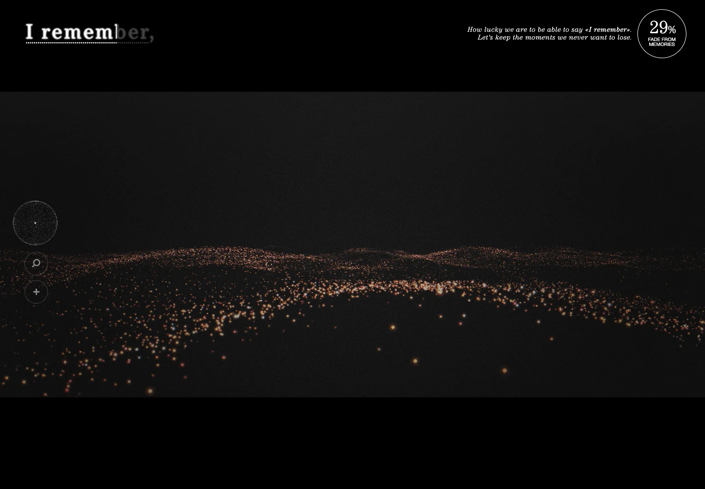
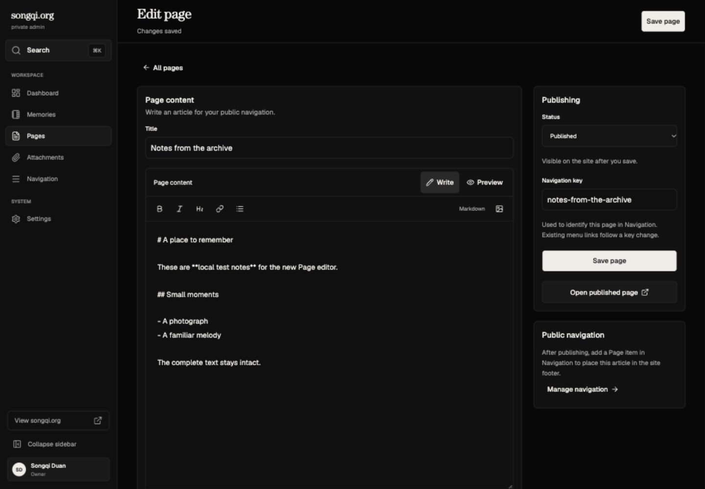

# Songqi — a home for memories

A self-hosted personal archive for stories, photos, Live Photos, video and audio. Visitors explore a three-dimensional galaxy, search for a memory, or read a story by its permanent link. The owner can also invite anonymous submissions. [Visit Songqi Duan’s archive · 段松岐](https://songqi.org)



## Publish a page

Use **Pages → New page** to write in Markdown. Choose **Published**, select **Show in footer navigation**, then **Save page**. Visitors can open the full page from the footer or its direct link. Use **Navigation** for custom labels, ordering and groups. Archiving a page withdraws it from public view.



## Self-host with Docker Compose

The Linux amd64 image runs the web app, private API and PostgreSQL 15. One persistent volume holds the database, uploads and generated authentication secret.

1. Clone the repository and prepare the environment file.

   ```sh
   git clone https://github.com/zerostwo/i-remember.fr.git
   cd i-remember.fr
   cp .env.example .env
   ```

2. Set `TAG` in `.env` to a published immutable `sha-…` tag. Set `I_REMEMBER_CANONICAL_URL` to your domain. [Published image tags](https://hub.docker.com/r/zerostwo/i-remember.fr/tags)

3. Start the app and check readiness.

   ```sh
   docker compose config --quiet
   docker compose pull app
   docker compose up -d --no-build app
   curl --fail http://127.0.0.1:7892/readyz
   ```

4. Create the owner account before exposing the site through HTTPS. In **Settings → Site**, set your public identity, contact and submission preferences. [Local owner setup](http://127.0.0.1:7892/admin/setup)

Keep the data volume across updates and back it up before each release. [Production deployment, backup and restore](docs/deployment.md)

## Develop locally

Use Node.js 22, pnpm 10.17.1 and a local PostgreSQL database. Set `DATABASE_URL`, a local `AUTH_SECRET`, and `API_TRUST_PROXY=true` for the supplied loopback web proxy.

```sh
pnpm install --frozen-lockfile
pnpm db:migrate
pnpm dev
```

Run `pnpm lint`, `pnpm typecheck`, `pnpm build` and `pnpm test` before release. The full suite uses PostgreSQL tools, FFmpeg, ExifTool and libheif. [Build and verification workflow](.github/workflows/docker.yml)

## Further reading

- [Media formats, upload limits and Apple Photos import](docs/media.md)
- [Architecture](docs/architecture.md) · [HTTP API](apps/api/README.md)
- [Homepage discovery and memory privacy](docs/seo.md) · [Changelog](CHANGELOG.md)
- [License and third-party asset rights](LICENSE)
