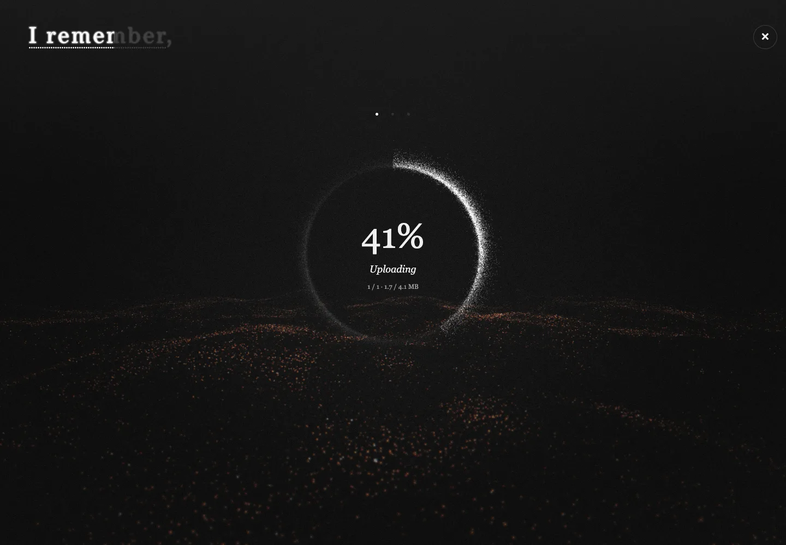

# Media uploads and playback

## Live Photos

Upload an Apple Live Photo by selecting its **unmodified HEIC/JPEG and same-name
MOV together**, or select a `.livp` / ZIP containing one pair. Export unmodified
originals from Photos on Mac to obtain both files. A browser photo picker may
provide only a still image; the website cannot reconstruct missing motion or sound.
One pair occupies one attachment slot. Limits: 100 MB combined, a 32 MB / 64 MP
still, and 30 seconds / 4K motion. The embedded Apple identifiers must match.

Opening the memory plays the Live Photo once, with its recorded sound, then shows
the actual key picture. **LIVE** replays it; if browser autoplay is blocked, tap
LIVE to start with sound. Playback stops when the memory closes or the tab hides,
and temporarily mutes the galaxy soundtrack. Card composition applies to motion
as well as the still; full-photo viewing and downloads keep the complete picture.

The download arrow saves a ZIP with `Memory.JPG` and `Memory.MOV`. Extract it and
import **both files together** using File → Import in Photos on a Mac. The files
share a fresh Apple pairing identifier and a key-picture time track, so they remain
a Live Photo. Safari on iPhone cannot import this ZIP directly into Photos; import
on Mac and sync through iCloud Photos. Export is JPEG plus H.264/AAC MOV (motion up
to 1920 pixels / 30 fps), not a byte-for-byte copy of the HEIC/HEVC source.

Both components are rebuilt from decoded media. GPS, capture dates, camera/device
fields, XMP/IPTC, source thumbnails, sensor tracks and original identifiers are
discarded. Only fresh Live Photo pairing/playback metadata is added. Temporary
source files stay outside public storage and are removed on success or failure.
New ordinary public/admin photo uploads also discard embedded metadata; existing
stored uploads are not retroactively rewritten. Visible text, faces and spoken
content are retained, as is the explicitly requested recorded sound.

The single Docker image includes FFmpeg, ExifTool and `heif-convert`. Local
development needs all three on PATH. `/api/live-photo-uploads` uses the same
chunk/status protocol as video uploads. No database migration is needed. Run
`node scripts/check-live-photo.mjs` for pairing, privacy, audio, key-picture,
archive and cleanup checks. On macOS, the test also generates an Apple-authored
HEIC/JPEG fixture and validates the download with `PHLivePhoto` without changing
the user's Photos library. Physical iPhone import and playback need device QA.

## Audio memories

Public and admin uploads accept MP3, M4A, WAV, OGG and FLAC (100 MB / 10 minutes
per file). Audio shares the six-item public gallery limit with photos and videos.
Chunked transfers and asynchronous FFmpeg conversion report real upload and
processing progress. Files are validated by their decoded streams, converted to
192 kbps MP3, and stored with a generated monochrome stardust cover. Source
files and embedded metadata are discarded after conversion. No database migration
is required; audio uses the existing attachment records.

Play audio directly inside its memory card, alongside the story. A soft field of stardust responds to the actual
frequency spectrum with subtle movement and brightness, with play/pause, seeking and volume controls below it; audio does not open a fullscreen viewer. Playback temporarily
mutes the galaxy soundtrack and restores it on pause or close. Reduced-motion
preferences use a static ring; background tabs stop visualization rendering.
Direct `/memory/:id` visits skip the homepage introduction and open the requested card as soon as its assets are ready.
The Web Audio analyser requires no microphone access. The shared upload session
protocol is also available at `/api/audio-uploads`; audio streaming supports Range
requests at its returned attachment URL. Run `node scripts/check-audio.mjs` to check
validation, conversion, cover generation and temporary-file cleanup.

## Photos, videos, and upload progress

Public submissions and the admin memory editor accept MP4, MOV and WebM alongside
JPEG, PNG, WebP and GIF. New public memories can contain up to six photos/videos/audio files
combined; existing larger albums remain readable. Videos are limited to 500 MB,
ten minutes and 4K input. The server generates a poster for the circular composition
step and square memory card, then converts video to H.264/AAC MP4 (up to 1920 pixels
on either side, 30 fps). Opening the card plays the complete frame with thin-line,
auto-hiding controls for playback, seeking, sound and full screen. Keyboard users
can tab through the controls; Space/K toggles playback and left/right seeks five
seconds when the player itself is focused. Changing media or closing stops playback.
Photo arrows are unframed, and gallery dots and arrows adapt to local image brightness.
Images that cannot be sampled retain white controls with contrasting shadows.
Gallery navigation does not count as another memory view. Source video is discarded after conversion.

The single Docker image includes FFmpeg/ffprobe. Local development needs both on
PATH. Run `node scripts/check-video.mjs` for decoder/limit/cleanup regression checks.
One video is processed at a time per web process; additional concurrent attempts
receive a retry message. Public and admin video uploads use 8 MB parts and poll
for conversion completion, so the 500 MB total does not require a single large
Cloudflare request or a long-lived HTTP response. Upload sessions expire after
30 minutes of inactivity; a server restart requires choosing the video again.
The direct `/api/upload-video` API still requires 501 MB request bodies and a
960-second upstream read timeout when used without the part-based workflow. Keep the upload
volume backed up with PostgreSQL; video files and generated posters live together.

Photo uploads default to 8 MB and 64 megapixels. Video size and duration limits
are editable in Site settings, with defaults of 500 MB and 10 minutes.

Upload progress illuminates the existing particle circle clockwise, with a
percentage and a short status inside it. File transfer uses actual bytes sent;
video conversion reports FFmpeg progress separately. Preparing and finishing
stages show an activity state until measurable progress is available. Additional
files return to the same composition flow after uploading. The admin editor
also shows attachment progress.

